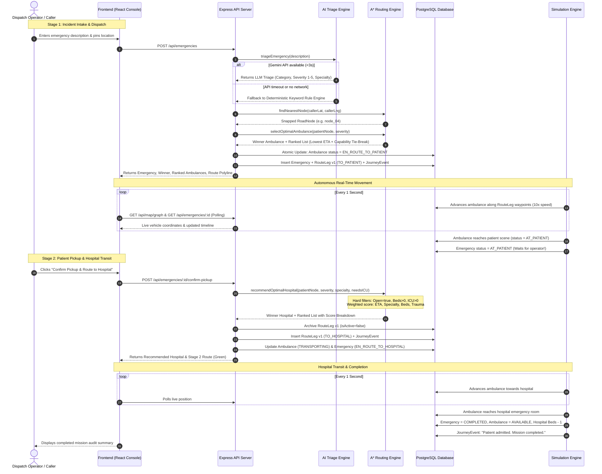

# 01. System Architecture & End-to-End Workflow

## 🌟 Overview
**LifeLine** is an emergency medical operations platform engineered to minimize emergency response times and eliminate critical bottleneck delays. It solves two major logistical phases in emergency medical response:
1. **Stage 1 (Dispatch to Patient Scene):** Swift, capability-informed ambulance selection and A\* route navigation to the caller's location.
2. **Stage 2 (Transit to Optimal Hospital):** Multi-criteria recommendation and dynamic routing to the best-suited, open hospital with confirmed bed availability and specialty matching.

---

## 🏛️ High-Level System Architecture

```text
┌────────────────────────────────────────────────────────────────────────┐
│                        CLIENT / DISPATCH CONSOLE                       │
│      React 19 + TypeScript + Leaflet Map + Real-Time Telemetry Polling  │
│                                                                        │
│   • Emergency Intake Form           • Live AI Triage Card              │
│   • Ranked Ambulance Table          • Interactive Solapur Map          │
│   • 2-Stage Journey Stepper         • Multi-Factor Hospital Card       │
│   • Chaos & Simulation Drawer       • Incident Audit Timeline          │
└───────────────────────────────────┬────────────────────────────────────┘
                                    │ HTTP / REST (Vite Proxy: /api)
┌───────────────────────────────────▼────────────────────────────────────┐
│                    EXPRESS + TYPESCRIPT BACKEND SERVER                 │
│                                                                        │
│  ┌────────────────────────┐  ┌──────────────────────────────────────┐  │
│  │    AI TRIAGE ENGINE    │  │       GRAPH & ROUTING SERVICE        │  │
│  │ • Gemini API (3s limit)│  │ • In-Memory Adjacency List           │  │
│  │ • ⚡ Offline Rule Engine│  │ • A* Pathfinding (Admissible Haversine│ │
│  │ • Zod Output Schema    │  │ • Dijkstra Uniform-Cost Baseline     │  │
│  └────────────────────────┘  └──────────────────────────────────────┘  │
│                                                                        │
│  ┌────────────────────────┐  ┌──────────────────────────────────────┐  │
│  │  AMBULANCE SELECTION   │  │        HOSPITAL RECOMMENDATION       │  │
│  │ • Lowest ETA (A*)      │  │ • Hard Constraints (Open, Beds > 0)  │  │
│  │ • Medical Tie-Breaks   │  │ • Multi-Factor Weighted Scoring      │  │
│  │ • Concurrency Locking  │  │ • Dynamic Severity Scaling           │  │
│  └────────────────────────┘  └──────────────────────────────────────┘  │
│                                                                        │
│  ┌────────────────────────┐  ┌──────────────────────────────────────┐  │
│  │    DYNAMIC REROUTE     │  │       SIMULATION KINEMATICS ENGINE   │  │
│  │ • Real-time road watch │  │ • Autonomous 1s Tick (10x Speed)     │  │
│  │ • Multi-version legs   │  │ • Waypoint Kinematic Progression     │  │
│  │ • Hospital re-divert   │  │ • Auto-Arrival at Patient Scene      │  │
│  └────────────────────────┘  └──────────────────────────────────────┘  │
└───────────────────────────────────┬────────────────────────────────────┘
                                    │ Prisma ORM 7 + PostgreSQL
┌───────────────────────────────────▼────────────────────────────────────┐
│                       POSTGRESQL DATABASE (SOLAPUR)                    │
│   • 26 Road Nodes   • 70 Bidirectional Edges   • 4 EMS Stations        │
│   • 10 Ambulances   • 6 Hospitals              • Audit Events Timeline │
└────────────────────────────────────────────────────────────────────────┘
```

---

## 📂 Monorepo Structure

```text
Hackthon-31OCT/
├── backend/
│   ├── prisma/
│   │   ├── migrations/          # Versioned PostgreSQL migration SQL files
│   │   ├── schema.prisma        # Complete database schema
│   │   └── seed.ts              # Database seeding entry point
│   ├── src/
│   │   ├── controllers/         # HTTP request/response handlers
│   │   │   ├── auth.controller.ts
│   │   │   ├── emergency.controller.ts
│   │   │   └── map.controller.ts
│   │   ├── router/              # Express routing definitions
│   │   │   ├── auth.router.ts
│   │   │   ├── emergency.router.ts
│   │   │   └── map.router.ts
│   │   ├── services/            # Pure business logic & algorithms
│   │   │   ├── ambulance-selection.service.ts
│   │   │   ├── graph.service.ts
│   │   │   ├── hospital-recommendation.service.ts
│   │   │   ├── reroute.service.ts
│   │   │   ├── routing.service.ts
│   │   │   ├── seed.service.ts
│   │   │   ├── simulation.service.ts
│   │   │   └── triage.service.ts
│   │   ├── middlewares/         # Auth & error handling middlewares
│   │   │   ├── auth.middlewares.ts
│   │   │   └── error.middleware.ts
│   │   ├── DB/                  # Prisma client initialization
│   │   │   └── prisma.ts
│   │   ├── utils/               # Shared response, error, hashing utilities
│   │   │   ├── apiError.ts
│   │   │   ├── apiResponce.ts
│   │   │   ├── hashPassword.ts
│   │   │   └── jwt.ts
│   │   ├── scripts/             # Automated test & verification suites
│   │   │   ├── verify-phase2.ts
│   │   │   ├── verify-triage.ts
│   │   │   ├── verify-api.ts
│   │   │   └── rigorous-e2e.ts
│   │   └── index.ts             # Express server entry point & simulation bootstrap
│   ├── .env                     # Backend environment configuration
│   ├── .env.example             # Template for environment configuration
│   ├── package.json
│   ├── tsconfig.json
│   └── prisma7.config.ts
│
├── frontend/
│   ├── src/
│   │   ├── components/          # Modular React components
│   │   │   ├── DispatchConsole.tsx
│   │   │   ├── Header.tsx
│   │   │   ├── HistoryView.tsx
│   │   │   ├── HowItWorksModal.tsx
│   │   │   ├── MapView.tsx
│   │   │   └── SimulationPanel.tsx
│   │   ├── api.ts               # Axios client & REST endpoint bindings
│   │   ├── types.ts             # TypeScript domain types & interfaces
│   │   ├── App.tsx              # Root dashboard & live polling coordinator
│   │   ├── main.tsx             # React DOM entry point
│   │   └── index.css            # Global CSS & Leaflet container styling
│   ├── vite.config.ts           # Vite build configuration & /api reverse proxy
│   ├── package.json
│   └── tsconfig.json
│
└── docs/                        # Complete technical documentation suite
```

---

## 🔄 End-to-End Emergency Sequence Workflow

The following sequence illustrates the full lifecycle of an emergency call through both stages:



