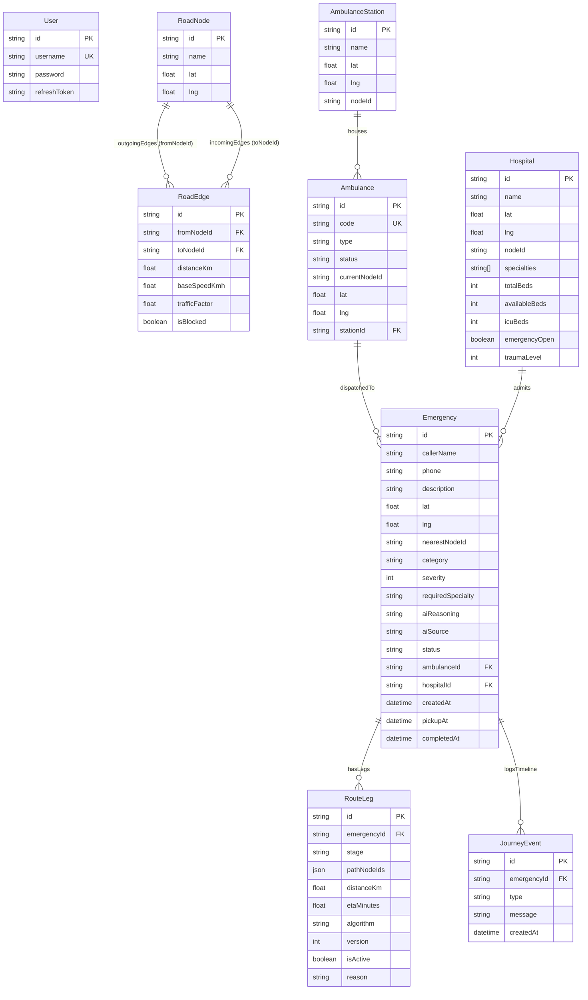

# 02. Database Architecture & Data Models

## 🐘 Technology Stack
- **Database Engine:** PostgreSQL 15+
- **ORM & Migrations:** Prisma 7 (`@prisma/client`, `@prisma/adapter-pg`)
- **Connection Configuration:** Configured in `prisma7.config.ts` and `.env`

---

## 🗺️ Entity-Relationship Diagram (ERD)

---

## 📋 Comprehensive Model Specifications

### 1. `RoadNode`
Represents an identifiable road junction, landmark, or intersection in the Solapur municipal road network.
- `id` (`String` @id @default(cuid())): Unique node identifier (e.g. `node_01`, `node_04`).
- `name` (`String`): Human-readable landmark name (e.g. "Saat Rasta Junction", "Civil Hospital Junction").
- `lat` (`Float`): Latitude coordinate in decimal degrees.
- `lng` (`Float`): Longitude coordinate in decimal degrees.

### 2. `RoadEdge`
Represents a directed road corridor connecting two nodes. Bidirectional roads are stored as two complementary directed edge records ($u \to v$ and $v \to u$).
- `id` (`String` @id @default(cuid())): Edge primary key.
- `fromNodeId` (`String`): Origin node foreign key.
- `toNodeId` (`String`): Destination node foreign key.
- `distanceKm` (`Float`): Great-circle distance in kilometers computed via the Haversine formula.
- `baseSpeedKmh` (`Float`): Posted or baseline vehicular speed limit (30 km/h city center, up to 60 km/h bypass highways).
- `trafficFactor` (`Float` @default(1.0)): Real-time congestion multiplier ($1.0\times$ = free flow, $2.5\times$ = moderate congestion, $5.0\times$ = severe jam).
- `isBlocked` (`Boolean` @default(false)): Administrative closure flag. If `true`, the edge is strictly pruned from the routing graph.

### 3. `AmbulanceStation`
Permanent emergency depot where ambulances are stationed.
- `id` (`String` @id @default(cuid())): Station identifier.
- `name` (`String`): Station name (e.g. "Central Solapur EMS Depot (Saat Rasta)").
- `lat` / `lng` (`Float`): Depot GPS location.
- `nodeId` (`String`): Closest road network junction.

### 4. `Ambulance`
An emergency medical response vehicle in the municipal fleet.
- `id` (`String` @id @default(cuid())): Vehicle primary key.
- `code` (`String` @unique): Vehicle license code (e.g. `MH-13-EM-103`).
- `type` (`String`): Medical equipment capability:
  - `BASIC`: Basic Life Support (BLS) — standard patient transport and first aid.
  - `ADVANCED`: Advanced Life Support (ALS) — cardiac defibrillator, IV medication, advanced airway.
  - `ICU`: Mobile Intensive Care Unit — onboard ventilator, critical care monitoring.
- `status` (`String` @default("AVAILABLE")): Operational state:
  - `AVAILABLE`: Idle at station, ready for dispatch.
  - `ASSIGNED`: Dispatched to emergency call.
  - `EN_ROUTE_TO_PATIENT`: Actively travelling to caller scene (Stage 1).
  - `AT_PATIENT`: On scene; paramedics stabilizing patient.
  - `TRANSPORTING`: Patient secured on board, en route to hospital (Stage 2).
  - `COMPLETED`: Mission finished, transitioning back to available.
  - `OFFLINE`: Maintenance, refueling, or out of service.
- `currentNodeId` (`String`): Last recorded junction checkpoint.
- `lat` / `lng` (`Float`): Real-time animated coordinate.
- `stationId` (`String`): Base station foreign key.

### 5. `Hospital`
Acute care hospital or medical center.
- `id` (`String` @id @default(cuid())): Hospital primary key.
- `name` (`String`): Hospital name.
- `lat` / `lng` (`Float`): Hospital entrance GPS coordinates.
- `nodeId` (`String`): Road network access junction.
- `specialties` (`String[]`): Supported emergency disciplines: `cardiac`, `trauma`, `neuro`, `burns`, `maternity`, `pediatric`, `general`, `respiratory`.
- `totalBeds` (`Int`): Total inpatient capacity.
- `availableBeds` (`Int`): Currently open, unassigned beds.
- `icuBeds` (`Int`): Specialized intensive care beds.
- `emergencyOpen` (`Boolean` @default(true)): Emergency department intake status.
- `traumaLevel` (`Int`): ACS Trauma designation (1 = Comprehensive Tertiary Trauma Center, 2 = Major Trauma, 3 = Community Stabilization).

### 6. `Emergency`
Central incident record storing caller details, triage outcome, and mission status.
- `id` (`String` @id @default(cuid())): Incident primary key.
- `callerName` (`String`), `phone` (`String`): Reporting party contact.
- `description` (`String`): Free-text description of caller complaint.
- `lat` / `lng` (`Float`): Incident GPS coordinates.
- `nearestNodeId` (`String`): Snapped road junction.
- `category` (`String`): AI-classified emergency discipline (`CARDIAC`, `TRAUMA`, etc.).
- `severity` (`Int`): Triage severity score on a 1–5 scale.
- `requiredSpecialty` (`String`): Primary clinical capability needed.
- `aiReasoning` (`String`): Decision-support justification generated by AI or rules.
- `aiSource` (`String`): Triage classification engine (`LLM` vs. `RULES`).
- `status` (`String`): Incident progression (`PENDING`, `EN_ROUTE_TO_PATIENT`, `AT_PATIENT`, `PICKUP_CONFIRMED`, `EN_ROUTE_TO_HOSPITAL`, `COMPLETED`, `CANCELLED`).
- `ambulanceId` (`String?`), `hospitalId` (`String?`): Assigned vehicle and destination hospital.
- `createdAt`, `pickupAt`, `completedAt`: Audit timestamps.

### 7. `RouteLeg`
A multi-versioned geometric path representing a journey stage.
- `id` (`String` @id @default(cuid())): Route leg primary key.
- `emergencyId` (`String`): Parent emergency foreign key.
- `stage` (`String`): `TO_PATIENT` (Stage 1) or `TO_HOSPITAL` (Stage 2).
- `pathNodeIds` (`Json`): Ordered sequence of node IDs defining the route polyline.
- `distanceKm` (`Float`): Road transit distance.
- `etaMinutes` (`Float`): Estimated travel time in minutes.
- `algorithm` (`String`): Algorithm employed (`A_STAR` or `DIJKSTRA`).
- `version` (`Int` @default(1)): Route revision number (incremented when rerouted).
- `isActive` (`Boolean` @default(true)): Active routing flag. When detoured, previous legs are archived with `isActive = false`.
- `reason` (`String?`): Justification for route revision (e.g. "Road X–Y blocked").

### 8. `JourneyEvent`
Immutable chronological audit log for forensic accountability.
- `id` (`String` @id @default(cuid())): Event primary key.
- `emergencyId` (`String`): Parent incident foreign key.
- `type` (`String`): Event category (`CREATED`, `TRIAGE`, `ASSIGNED`, `AT_PATIENT`, `PICKUP_CONFIRMED`, `HOSPITAL_RECOMMENDED`, `REROUTE`, `COMPLETED`, `CANCELLED`).
- `message` (`String`): Descriptive narrative of the operational milestone.
- `createdAt` (`DateTime` @default(now())): Precise event timestamp.

---

## 📍 Solapur Seed Topology Details
The simulated road graph models the city of **Solapur, Maharashtra, India** (Latitude ~17.66° N, Longitude ~75.91° E):
- **26 Nodes:** Strategic arterial junctions spanning Old Pune Naka, Saat Rasta, D-Mart Jule Solapur, Ashok Chowk, Hotgi Road Airport Chowk, and Civil Hospital.
- **70 Directed Edges:** Interconnecting all nodes with realistic urban speeds (30–60 km/h) and redundant loops to test alternative detours.
- **4 EMS Stations:** Strategically distributed across Central, North, South, and East Solapur.
- **10 Ambulances:**
  - 7 Available (`MH-13-EM-101`, `MH-13-EM-102`, `MH-13-EM-103`, `MH-13-EM-201`, `MH-13-EM-202`, `MH-13-EM-301`, `MH-13-EM-302`).
  - 3 Busy/Offline (`MH-13-EM-401` ASSIGNED, `MH-13-EM-402` TRANSPORTING, `MH-13-EM-104` OFFLINE).
- **6 Hospitals:**
  1. *Dr. V.M. Govt Medical College & Civil Hospital* (Level 1 Trauma, 250 beds, open).
  2. *Ashwini Sahakari Rugnalaya & Heart Centre* (Level 1 Cardiac, 180 beds, open).
  3. *Markandey Memorial Hospital* (Level 2 Pediatric/Maternity, 100 beds, open).
  4. *Solapur Neuro & Trauma Speciality Centre* (Level 2 Neuro/Burns, 80 beds, open).
  5. *Lifecare Multi-Specialty Hospital* (Level 3, **0 Available Beds** — included to demonstrate capacity filtering).
  6. *City Metro Emergency Clinic* (**Emergency Department Closed** — included to demonstrate admission filtering).

