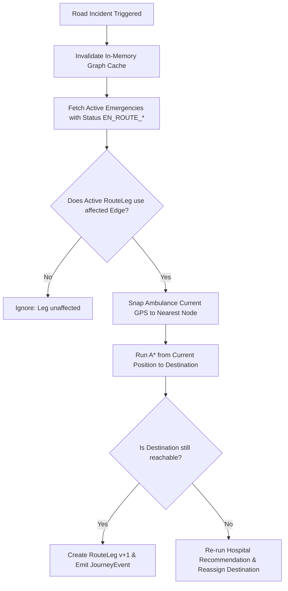

# 🧮 Core Algorithms: Routing, Dispatch & Scoring

This document provides a mathematical and technical breakdown of the core algorithmic engines in **LifeLine**. All algorithms are implemented as pure, deterministic, and unit-tested services in `backend/src/services/`.

---

## 1. Graph Representation & Edge Cost Function

The Solapur municipal road network is modeled as a directed weighted graph $G = (V, E)$, where:
- $V$: Set of Road Nodes (junctions, roundabouts, landmarks).
- $E$: Set of directed Road Edges. Bidirectional streets are represented by two antiparallel edges $(u, v)$ and $(v, u)$.

### Edge Weight (Cost) Formulation
Each directed edge $e = (u, v)$ has:
- $d(e)$: Distance in kilometers ($\text{km}$).
- $s(e)$: Base legal speed limit in kilometers per hour ($\text{km/h}$).
- $T(e)$: Traffic factor ($T \ge 1.0$, where $1.0$ is free-flow, $2.0$ represents severe congestion causing speed to halve).
- $B(e) \in \{\text{true}, \text{false}\}$: Roadblock state.

The effective traversal time $C(e)$ in minutes is:

$$
v_{\text{eff}}(e) = \frac{s(e)}{T(e)}
$$

$$
C(e) = \left( \frac{d(e)}{v_{\text{eff}}(e)} \right) \times 60 = \left( \frac{d(e) \cdot T(e)}{s(e)} \right) \times 60
$$

**Exclusion Rule:** If $B(e) = \text{true}$, $e \notin E_{\text{traversable}}$ and the edge is excluded from the adjacency list during graph construction.

```typescript
// backend/src/services/graph.service.ts
const effectiveSpeed = Math.max(5, edge.baseSpeedKmh / Math.max(0.1, edge.trafficFactor));
const costMinutes = (edge.distanceKm / effectiveSpeed) * 60;
```

---

## 2. Pathfinding: A* vs. Dijkstra

LifeLine implements both **A\*** (default for operational dispatch) and **Dijkstra's Algorithm** (used for benchmarking and validation).

### Heuristic Function & Admissibility Proof
A\* searches the state space using the evaluation function:

$$
f(n) = g(n) + h(n)
$$

Where:
- $g(n)$: Exact travel time from start node to current node $n$ (minutes).
- $h(n)$: Estimated travel time from node $n$ to destination $g$.

To guarantee that A\* finds the **globally optimal shortest path**, $h(n)$ must be **admissible** (it must never overestimate the true cost to reach the goal):

$$
\forall n \in V, \quad h(n) \le h^*(n)
$$

LifeLine defines $h(n)$ using the **Great-Circle Haversine Distance** divided by the **global theoretical maximum speed limit** of the entire network ($v_{\text{max}} = \max_{e \in E} s(e)$):

$$
h(n) = \frac{\text{haversine}(n, \text{goal})}{v_{\text{max}}} \times 60
$$

#### Mathematical Proof of Admissibility:
1. The great-circle distance $\text{haversine}(n, \text{goal})$ is the Euclidean geodesic distance on a sphere and is the absolute lower bound on physical travel distance: $\text{haversine}(n, \text{goal}) \le d_{\text{road}}(n, \text{goal})$.
2. No vehicle can physically travel faster than $v_{\text{max}}$, so $\forall e, v_{\text{eff}}(e) \le v_{\text{max}}$.
3. Therefore:

$$
\frac{\text{haversine}(n, \text{goal})}{v_{\text{max}}} \le \frac{d_{\text{road}}(n, \text{goal})}{v_{\text{eff}}} = h^*(n)
$$

Hence, $h(n)$ is **strictly admissible** and **consistent** (monotonic), ensuring that no node is expanded with an underestimated cost and A\* returns the optimal route without re-opening closed nodes.

### Performance Comparison

| Metric | Dijkstra's Algorithm | A\* Search (Admissible Haversine) |
| :--- | :--- | :--- |
| **Exploration Pattern** | Radial / Concentric circles | Directed ellipse towards goal |
| **Nodes Explored (Avg)** | 22 – 26 nodes (full graph search) | 8 – 14 nodes (~50% reduction) |
| **Optimality Guarantee** | 100% Globally Optimal | 100% Globally Optimal |
| **Time Complexity** | $O((|V| + |E|) \log |V|)$ | $O((|V| + |E|) \log |V|)$ (worst-case), $O(b^d)$ typical |
| **Use Case** | All-pairs pre-computation & benchmark | Live emergency vehicle routing |

---

## 3. Nearest Node Snapping

Because emergency 911/112 callers and GPS tracking units emit arbitrary floating-point coordinates $(\phi, \lambda)$, LifeLine snaps GPS coordinates to the road network:

$$
n^* = \arg\min_{n \in V} \text{haversine}(\phi, \lambda, n.\text{lat}, n.\text{lng})
$$

The Haversine formula calculates spherical angular distance:

$$
a = \sin^2\left(\frac{\Delta \phi}{2}\right) + \cos(\phi_1)\cos(\phi_2)\sin^2\left(\frac{\Delta \lambda}{2}\right)
$$

$$
d = 2 R \cdot \arcsin\left(\sqrt{a}\right), \quad R = 6371 \text{ km}
$$

---

## 4. Capability-Weighted Ambulance Selection

Instead of dispatching based merely on straight-line distance, LifeLine evaluates **all** currently `AVAILABLE` ambulances using A\* routing, then applies a clinical suitability adjustment based on triage severity.

### Effective ETA Formulation
For each available ambulance $a \in \mathcal{A}_{\text{available}}$:

$$
\text{Effective ETA}(a) = \text{RouteETA}(a.\text{currentNodeId} \to \text{patientNodeId}) + P_{\text{suitability}}(a, \text{severity})
$$

### Suitability Penalty Schedule

#### Case 1: Critical Emergency ($\text{Severity} \ge 4$)
In life-threatening emergencies (e.g., Cardiac Arrest, Severe Polytrauma), deploying an ambulance with Advanced Life Support (ALS) or Intensive Care Unit (ICU) equipment is clinically critical.

- **ICU Unit**: $P_{\text{suitability}} = 0.0\text{ min}$ (Full ICU onboard ventilator/defibrillator).
- **ADVANCED Unit**: $P_{\text{suitability}} = 0.5\text{ min}$ (Paramedic ALS capability).
- **BASIC Unit**: $P_{\text{suitability}} = +3.0\text{ min}$ (BLS vehicle receives a 3-minute penalty to favor ALS/ICU).

#### Case 2: Non-Critical Emergency ($\text{Severity} \le 3$)
To preserve scarce ICU and ALS units for unexpected critical events:
- **BASIC Unit**: $P_{\text{suitability}} = 0.0\text{ min}$ (Optimal for non-life-threatening transfer).
- **ADVANCED Unit**: $P_{\text{suitability}} = +0.3\text{ min}$.
- **ICU Unit**: $P_{\text{suitability}} = +0.8\text{ min}$ (Preserved for high-trauma cases).

### Output
The service returns:
1. **Winner**: Ambulance with $\min(\text{Effective ETA})$.
2. **Ranked Candidate List**: Complete breakdown of distance, raw ETA, penalty, and justification for UI transparency and audit review.

---

## 5. Multi-Factor Hospital Recommendation

Hospital recommendation executes **only after the patient is secured onboard** (`confirm-pickup`), avoiding premature bed reservation.

### Step 1: Hard Clinical Filters
A hospital $H$ is disqualified if any of the following conditions hold:
1. $\text{emergencyOpen} = \text{false}$: Emergency department closed or in divert mode.
2. $\text{availableBeds} \le 0$: Zero general admission capacity.
3. $\text{needsICU} = \text{true} \land \text{icuBeds} \le 0$: Patient requires critical care but no ICU beds exist.
4. $\text{isReachable}(n_{\text{patient}} \to H.\text{nodeId}) = \text{false}$: Road network blockades prevent physical access.

### Step 2: Multi-Factor Objective Scoring Formula
For all eligible hospitals, LifeLine computes a normalized penalty score $S \in [0, 1]$ (lower is better):

$$
S = w_{\text{eta}} \cdot \tilde{T} + w_{\text{spec}} \cdot P_{\text{spec}} + w_{\text{beds}} \cdot P_{\text{beds}} + w_{\text{trauma}} \cdot P_{\text{trauma}}
$$

Where:
- **Normalized Travel Time ($\tilde{T}$)**:
  $$\tilde{T} = \min\left(1.0, \frac{\text{RouteETA}(n_{\text{patient}} \to H.\text{nodeId})}{30.0}\right)$$
- **Specialty Mismatch Penalty ($P_{\text{spec}}$)**:
  $$P_{\text{spec}} = \begin{cases} 0.0 & \text{if required specialty matches or general} \\ 1.0 & \text{if required specialty is missing} \end{cases}$$
- **Bed Saturation Penalty ($P_{\text{beds}}$)**:
  $$P_{\text{beds}} = \max\left(0.0, 1.0 - \min\left(1.0, \frac{H.\text{availableBeds}}{50}\right)\right)$$
- **Trauma Level Penalty ($P_{\text{trauma}}$)**:
  $$P_{\text{trauma}} = \min\left(1.0, \frac{H.\text{traumaLevel} - 1}{2}\right)$$
  *(Level 1 Trauma Center penalty = 0.0, Level 2 = 0.5, Level 3 = 1.0)*

### Dynamic Severity Weighting

| Weight Category | Standard Emergency ($\text{Severity} < 5$) | Critical Emergency ($\text{Severity} = 5$) | Rationale |
| :--- | :--- | :--- | :--- |
| **ETA Weight ($w_{\text{eta}}$)** | **0.50** | **0.70** | "Golden Hour" priority: time to definitive care dominates |
| **Specialty Weight ($w_{\text{spec}}$)** | **0.25** | **0.15** | Specialist care is critical but proximity overrides delay |
| **Bed Capacity ($w_{\text{beds}}$)** | **0.15** | **0.10** | Emergency triage can stabilize even in high occupancy |
| **Trauma Center ($w_{\text{trauma}}$)** | **0.10** | **0.05** | Baseline facility capability |

---

## 6. Dynamic Rerouting & Invalidation Engine

When a road incident occurs (e.g., major traffic collision on Saat Rasta, tree fall, or congestion surge):



### Invalidation Logic:
1. `invalidateGraphCache()` clears the cached adjacency matrix.
2. For each active emergency in `EN_ROUTE_TO_PATIENT` or `EN_ROUTE_TO_HOSPITAL`:
   - Inspect the node sequence $[v_0, v_1, \dots, v_k]$ in `activeLeg.pathNodeIds`.
   - If $(v_i = u \land v_{i+1} = w)$ or $(v_i = w \land v_{i+1} = u)$ matches the altered edge:
     - Determine the ambulance's current live coordinate $(\phi_{\text{amb}}, \lambda_{\text{amb}})$.
     - Compute new detour: $\text{findRouteAStar}(n_{\text{current}}, n_{\text{target}})$.
     - Mark existing `RouteLeg` as `isActive: false`.
     - Insert new `RouteLeg` with `version: oldVersion + 1`, `reason: "Detour: Road X–Y blocked"`.
     - Insert a `JourneyEvent` documenting the ETA change: e.g., `"Rerouted: Road Blocked. ETA changed from 6.2m to 8.4m (+2.2m)"`.

