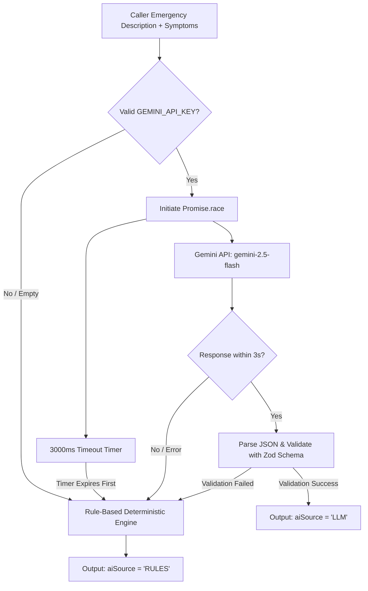

# 🤖 AI Triage Engine: Pretrained LLM & Deterministic Fallback

This document explains the architecture, prompt engineering, schema enforcement, and offline resilience of the **AI Triage Engine** in LifeLine (`backend/src/services/triage.service.ts`).

---

## 1. System Philosophy & Ethical Boundaries

> [!IMPORTANT]
> **Decision Support Only:** The AI triage engine functions solely as a dispatch classification assistant. It suggests vehicle capability requirements (Basic, Advanced, ICU) and clinical specialty routing. **It never diagnoses patients or replaces qualified medical personnel.**

To maintain absolute reliability in life-critical operations:
1. **AI Scope is Isolated to Triage:** The LLM is used **only** to interpret unstructured natural language call descriptions into structured clinical dimensions.
2. **Routing & Dispatch Remain Purely Deterministic:** The algorithmic layers (A\* routing, ambulance ranking, hospital scoring) remain 100% deterministic, explainable, and reproducible.
3. **Zero Single Point of Failure:** If the AI API experiences network failure or latency exceeding 3 seconds, the system instantly switches to a deterministic, offline rule-based classification engine.

---

## 2. Architecture & Data Flow



---

## 3. Google Gemini Integration

### Configuration
The service utilizes the modern `@google/genai` SDK:
- **API Key:** `process.env.GEMINI_API_KEY`
- **Model:** `process.env.TRIAGE_MODEL || "gemini-2.5-flash"`
- **Response Format:** `application/json` enforced natively via `config.responseMimeType`.

### Prompt Engineering
The system prompt enforces strict constraints to prevent hallucinations and eliminate conversational filler:

```typescript
const systemPrompt = `You are a clinical decision-support triage assistant for emergency ambulance dispatch.
Analyze the caller's emergency description and classify it into triage attributes.
This output is decision support only for ambulance vehicle and hospital dispatch, never a clinical diagnosis.

You MUST reply with ONLY a single valid JSON object with NO markdown formatting, NO backticks, and NO extraneous text:
{
  "category": "CARDIAC" | "TRAUMA" | "STROKE" | "BURNS" | "RESPIRATORY" | "MATERNITY" | "PEDIATRIC" | "GENERAL",
  "severity": <integer 1 to 5, where 1 is non-urgent and 5 is immediately life-threatening>,
  "requiredSpecialty": "<cardiac|trauma|neuro|burns|respiratory|maternity|pediatric|general>",
  "needsICU": <true | false>,
  "reasoning": "<one or two concise sentences explaining triage justification>"
}`;
```

---

## 4. Zod Schema Validation & Clamping

Every LLM response is parsed and passed through a rigorous Zod schema:

```typescript
export const TriageOutputSchema = z.object({
    category: z.enum([
        "CARDIAC",
        "TRAUMA",
        "STROKE",
        "BURNS",
        "RESPIRATORY",
        "MATERNITY",
        "PEDIATRIC",
        "GENERAL",
    ]),
    severity: z.number().int().min(1).max(5),
    requiredSpecialty: z.string().min(1),
    needsICU: z.boolean(),
    reasoning: z.string().min(1),
});
```

### Defensive Sanitization:
Even if the model produces borderline numbers (e.g., severity `6` or string `"5"`), values are defensively clamped:
```typescript
severity: Math.min(5, Math.max(1, Number(parsedRaw.severity) || 3))
```

---

## 5. Offline 3-Second Timeout & Fallback Rule Engine

In a hackathon venue or disaster setting where mobile data may be degraded, latency is intolerable. LifeLine executes an asynchronous race:

```typescript
const timeoutPromise = new Promise<never>((_, reject) => {
    setTimeout(() => reject(new Error("Gemini API triage request timed out (3s threshold)")), 3000);
});

const response = await Promise.race([apiCallPromise, timeoutPromise]);
```

### Deterministic Keyword Rule Engine (`ruleBasedTriage`)
If the API fails, times out, or no key is present, the fallback engine scans the description and symptoms against a medical keyword dictionary:

| Priority | Category | Match Keywords | Severity | Specialty | ICU Required |
| :---: | :--- | :--- | :---: | :--- | :---: |
| **1** | `CARDIAC` | chest pain, heart, cardiac, angina, heart attack, palpitation | **5** | cardiac | **true** |
| **2** | `STROKE` | stroke, slurred, unconscious, face droop, paralysis, fainting | **5** | neuro | **true** |
| **3** | `BURNS` | burn, fire, scald, acid, flame, smoke inhalation | **4** | burns | **true** |
| **4** | `TRAUMA` | accident, bleeding, fracture, collision, stab, fall, head injury | **4** | trauma | **true** |
| **5** | `RESPIRATORY` | breath, asthma, suffocation, wheezing, choking, oxygen | **4** | respiratory | **true** |
| **6** | `MATERNITY` | pregnant, labour, delivery, bleeding pregnancy, water broke | **3** | maternity | **false** |
| **7** | `PEDIATRIC` | child, infant, baby, toddler, pediatric | **4** | pediatric | **false** |
| **8** | `GENERAL` | *(Default fallback if no high-risk keywords match)* | **2** | general | **false** |

---

## 6. Transparency: `aiSource` Metadata

Every emergency record in PostgreSQL stores the origin of the triage classification:
- `aiSource: "LLM"`: Processed by Gemini API.
- `aiSource: "RULES"`: Processed by the local deterministic rule engine.

### User Interface Presentation:
The frontend operator console renders distinct status badges:
- 🟢 **`AI Triage (Gemini 2.5-Flash)`**: Highlights machine learning inference.
- 🟡 **`Rule-based Triage (Offline Fallback)`**: Guarantees zero downtime and complete situational awareness for dispatchers.

