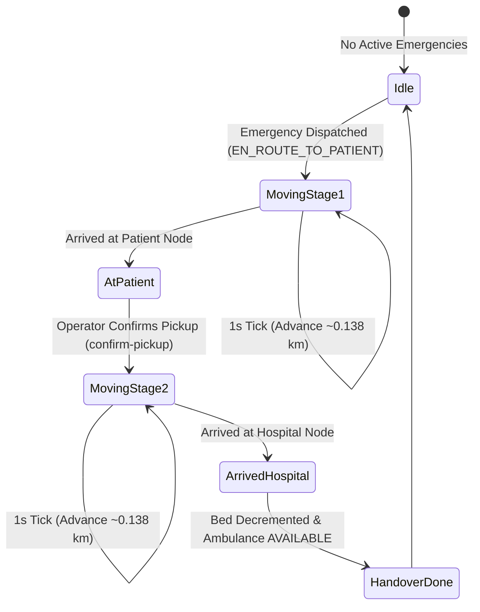

# ⏱️ Autonomous Simulation Engine & Kinematics

This document describes the design, mathematical kinematics, and state progression of the **LifeLine Autonomous Simulation Engine** (`backend/src/services/simulation.service.ts`).

---

## 1. Simulation Philosophy

In high-stakes hackathon demonstrations and operational rehearsals, manual stepping is cumbersome and lacks visual realism. LifeLine features an **autonomous background physics loop** that runs inside the Node.js process:

- **Zero-Manual Overhead:** Once an emergency is dispatched, ambulances automatically traverse the road network.
- **Time Compression ($10\times$):** Solapur urban travel times (which typically take 10–25 minutes in real life) are compressed to **60–150 seconds**, providing instant visual gratification for evaluators.
- **Realistic Kinematics:** Vehicles do not jump teleportively; they smoothly traverse road segments waypoint-by-waypoint at realistic velocity.

---

## 2. Background Loop Architecture



### The 1-Second Interval Heartbeat
When the backend server initializes (`backend/src/index.ts`), `startSimulationLoop()` is started:

```typescript
export function startSimulationLoop() {
    setInterval(async () => {
        try {
            await simulationTick(10); // 10x speed compression
        } catch (err) {
            console.error("Simulation tick error:", err);
        }
    }, 1000); // 1 real second
}
```

---

## 3. Mathematical Kinematics & Waypoint Progression

### Speed & Distance Formulation
For each active journey:
- Baseline urban velocity: $v_{\text{base}} = 50\text{ km/h}$.
- Time compression factor: $C_t = 10$.
- Step duration: $\Delta t = 1.0\text{ s} = \frac{1}{3600}\text{ h}$.

The physical distance $\Delta d$ traversed per heartbeat tick is:

$$
\Delta d = \left( \frac{v_{\text{base}}}{3600} \right) \times C_t = \left( \frac{50}{3600} \right) \times 10 \approx 0.1388\text{ km} \quad (138.8\text{ meters per tick})
$$

### Waypoint Following Algorithm
Each active `RouteLeg` contains an ordered list of road node IDs:

$$
\mathcal{P} = [v_0, v_1, v_2, \dots, v_k]
$$

1. **Current Segment Identification:** Find index $i$ of the ambulance's current node $v_i$. The next target node is $v_{i+1}$.
2. **Distance Calculation:** Calculate geodesic distance to target:
   $$d_{\text{target}} = \text{haversine}(\text{lat}_{\text{amb}}, \text{lng}_{\text{amb}}, v_{i+1}.\text{lat}, v_{i+1}.\text{lng})$$
3. **Threshold Check:**
   - **Case A ($d_{\text{target}} \le \Delta d$):** Ambulance reaches $v_{i+1}$. Update ambulance coordinates $(\text{lat}, \text{lng})$ and `currentNodeId = v_{i+1}.id`.
   - **Case B ($d_{\text{target}} > \Delta d$):** Ambulance moves along the chord towards $v_{i+1}$ by a fraction $f = \frac{\Delta d}{d_{\text{target}}}$:
     $$\phi_{\text{new}} = \phi_{\text{current}} + f \cdot (\phi_{i+1} - \phi_{\text{current}})$$
     $$\lambda_{\text{new}} = \lambda_{\text{current}} + f \cdot (\lambda_{i+1} - \lambda_{\text{current}})$$

---

## 4. Lifecycle Milestones & Automated Handshakes

### Milestone 1: Arrival at Patient Location
When the vehicle arrives at the final waypoint of Stage 1 ($v_k = n_{\text{patient}}$):
1. Ambulance status switches to `AT_PATIENT`.
2. Emergency status switches to `AT_PATIENT`.
3. **Intentional Pause:** The simulation halts forward progression for this vehicle, simulating paramedic on-scene assessment and patient loading.
4. **UI Prompt:** The Dispatch Console highlights the emergency with a pulsing Amber badge and activates the **`Confirm Patient Pickup`** button.

### Milestone 2: Stage 2 Hospital Journey
When the operator clicks `Confirm Patient Pickup`:
1. Multi-factor hospital recommendation selects the optimal facility (e.g., Ashwini Sahakari).
2. Stage 2 `RouteLeg` (`TO_HOSPITAL`) is recorded in PostgreSQL.
3. Status switches to `EN_ROUTE_TO_HOSPITAL`.
4. The simulation loop immediately resumes kinematics towards the hospital gate.

### Milestone 3: Hospital Arrival & Auto-Handover
When the ambulance reaches the destination hospital node:
1. Patient transfer is finalized: Emergency status transitions to `COMPLETED`.
2. Hospital bed capacity is decremented atomically (`availableBeds = availableBeds - 1`).
3. If ICU was required: `icuBeds = icuBeds - 1`.
4. Ambulance status is restored to `AVAILABLE`, enabling immediate redispatch.

---

## 5. Live Chaos Injection

The simulation engine allows live disturbance testing to demonstrate dynamic adaptation:

### 1. Dynamic Roadblock (`PATCH /api/map/roads/:edgeId/block`)
- Instantly closes a road segment (e.g., Saat Rasta to Ashok Chowk).
- Active ambulances traveling on that road detect the obstruction, recalculate a detour using A\*, and update their trajectory in real time.

### 2. Traffic Surge (`PATCH /api/map/roads/:edgeId/traffic`)
- Increases traffic factor from $1.0$ to $3.0$ (simulating heavy market congestion).
- Edge traversal time triples, causing active ETAs to dynamically update.

### 3. Immediate Factory Reset (`POST /api/simulation/reset`)
- Completely flushes active calls, restores bed counts, resets road states, and positions fleet back at home stations.

